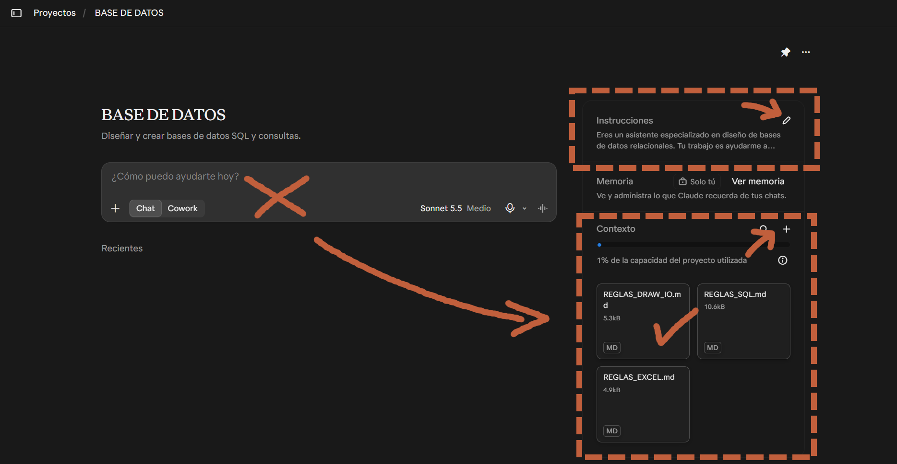
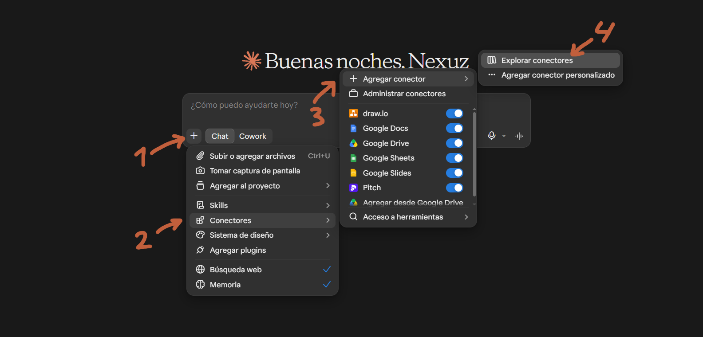
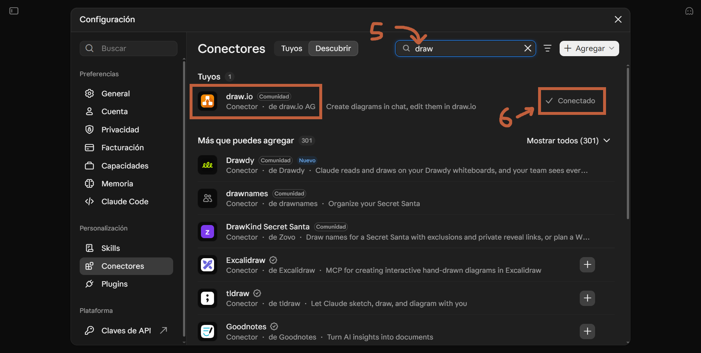
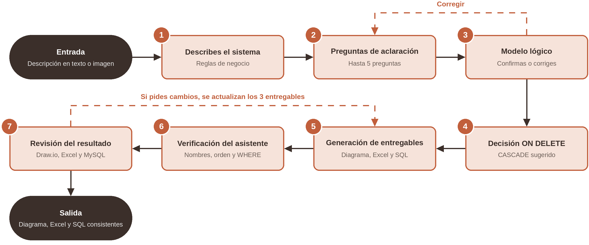
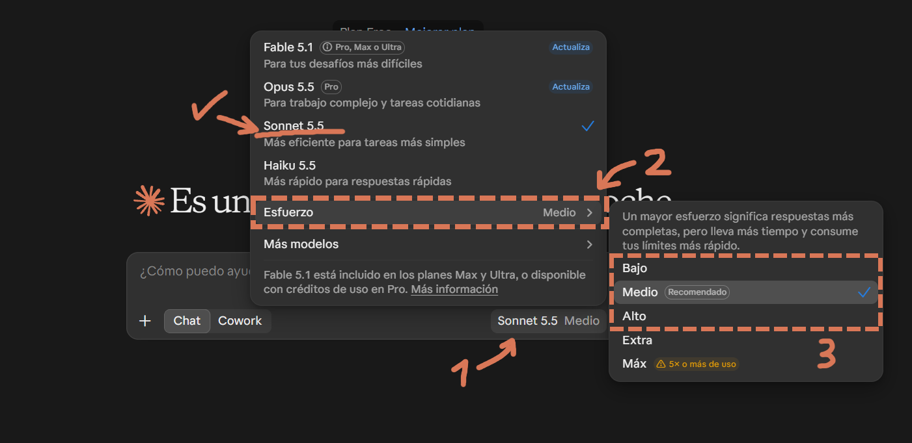

# NXZ DB Assistant

**Diseño y modelado de bases de datos con Claude (Free)**

*Diseño, modelado, consultas, poblado e ingeniería inversa. Fácil y rápido.*


Un asistente de IA configurado con reglas propias que te guía en el diseño de una base de datos relacional de principio a fin. Describes tu sistema y recibes tres entregables consistentes entre sí: el diagrama de clases, el modelo relacional en Excel y el script SQL.

Proyecto desarrollado para la materia **Base de Datos 1** (UAGRM - FICCT).

## Contenido

- [¿Qué obtienes?](#qué-obtienes)
- [Cómo funciona](#cómo-funciona)
- [Instalación](#instalación)
- [Flujo de trabajo](#flujo-de-trabajo)
- [Reglas del proyecto](#reglas-del-proyecto)
- [Consejos](#consejos)
- [Estructura del repositorio](#estructura-del-repositorio)
- [Licencia y aviso](#licencia-y-aviso)

## ¿Qué obtienes?

- **Diagrama de clases:** editable en Draw.io, con clases, relaciones y multiplicidades
- **Modelo relacional en Excel:** un bloque por tabla, con claves identificadas y datos de ejemplo
- **Script SQL para MySQL:** tablas, claves, datos de ejemplo y las consultas que necesites
- **Consistencia total:** los mismos nombres y las mismas claves en los tres entregables
- **Camino inverso:** a partir de un código o un modelo existente, reconstruye los demás entregables

## Cómo funciona

El sistema usa un **proyecto de Claude** con dos piezas: tres **archivos de reglas** (uno por entregable) y las **instrucciones del proyecto**, que definen el comportamiento del asistente. Así las reglas quedan guardadas en el proyecto y no tienes que reenviarlas en cada conversación.

**Requisitos de la IA:** entrada de texto e imagen, generación de archivos (Excel y código), conexión con Draw.io e instrucciones por proyecto. Claude cumple todo esto, incluso en su plan gratuito.

## Instalación

**1. Crea una cuenta o inicia sesión** en [claude.ai](https://claude.ai).

**2. Crea un nuevo proyecto.** La cuenta gratuita permite hasta cinco proyectos.

**3. Carga los archivos de reglas** de la carpeta [`reglas/`](reglas) en los **archivos de contexto** del proyecto (panel derecho). No los subas al chat, y conserva sus nombres exactos: las instrucciones los buscan por nombre.

**4. Pega las instrucciones del proyecto.** Copia el texto de [`instrucciones/INSTRUCCIONES_PROYECTO.md`](instrucciones/INSTRUCCIONES_PROYECTO.md) en la sección **Instrucciones** del proyecto (parte superior derecha).



**5. Conecta Draw.io.** En un chat del proyecto pulsa el botón **+**, elige **Conectores**, luego **Agregar conector** y **Explorar conectores**, y activa **draw.io**. Sin este paso el asistente no puede generar el diagrama.





Con estos cinco pasos el sistema queda listo. Abre un chat dentro del proyecto y empieza a describir tu sistema.

## Flujo de trabajo



1. **Describes el sistema:** en texto o con un esquema o captura
2. **Preguntas de aclaración:** el asistente hace hasta cinco preguntas si faltan datos
3. **Modelo lógico:** recibes un resumen y confirmas o corriges. No se genera ningún archivo hasta que lo apruebas
4. **Decisión sobre `ON DELETE`:** el asistente sugiere `CASCADE` y pregunta si alguna relación debe comportarse distinto
5. **Generación de entregables:** diagrama, Excel y script SQL, en ese orden
6. **Verificación del asistente:** orden de las tablas, nombres, `WHERE` en cada `UPDATE` y `DELETE`, y `ON DELETE` en todas las claves foráneas
7. **Revisión del resultado:** abres el diagrama en Draw.io, revisas el Excel y ejecutas el script en MySQL Workbench

Si pides un cambio en un entregable, el asistente actualiza los otros dos para que sigan siendo consistentes.

## Reglas del proyecto

| Entregable | Archivo | Puntos principales |
| --- | --- | --- |
| Diagrama de clases (Draw.io) | [`REGLAS_DRAW_IO.md`](reglas/REGLAS_DRAW_IO.md) | Estilo StarUML en blanco y negro, atributos sin tipos, multiplicidades `mín..máx`, composición, agregación y generalización |
| Modelo relacional (Excel) | [`REGLAS_EXCEL.md`](reglas/REGLAS_EXCEL.md) | Un bloque por tabla, estilos según el tipo de clave, claves foráneas con la regla `LLAVE + CLASE` |
| Script SQL | [`REGLAS_SQL.md`](reglas/REGLAS_SQL.md) | Orden fijo, tipos de dato, `ON UPDATE CASCADE` y `ON DELETE` explícito, consultas con comentarios en español |

**La regla que une los tres:** nombres de tablas, columnas y atributos en mayúsculas, sin espacios ni guiones bajos y con las tablas en singular. Cada clave foránea existe en el diagrama, en el Excel y en el SQL con el mismo nombre.

## Consejos

**Describe bien tu sistema.** Indica las entidades y sus atributos, el identificador de cada una, las relaciones con mínimo y máximo (por ejemplo, "un cliente puede tener cero o muchas ventas"), las relaciones todo-parte, las jerarquías, los datos propios de cada relación y las consultas que esperas.

**Elige bien el modelo.**



- **Recomendado:** Claude Sonnet 5.5. Evita modelos más básicos como Haiku, porque pueden equivocarse en alguna sección o no captar bien tu petición
- **Razonamiento medio:** para el primer resultado, al importar los archivos
- **Razonamiento bajo:** para ajustes, modificaciones y exportación de archivos
- **Razonamiento alto:** solo para tareas muy complejas, con muchas tablas o mucha información

**Cuida la cuota gratuita.**

- Entre semana, entre las 8:00 y las 14:00, la cuota se consume entre 3 y 5 veces más rápido, así que conviene evitar ese horario
- En Claude Free el uso se reinicia cada cinco horas
- Ten lista tu descripción antes de empezar, para no gastar mensajes en aclaraciones

**Errores comunes.**

- Cargar los archivos en el chat y no en el proyecto
- Olvidar pegar las instrucciones del proyecto
- No activar el conector de Draw.io
- Dejar `ON DELETE CASCADE` sin pensar en tablas de historial
- Ejecutar el script por partes o con la base de datos ya creada
- Usar MySQL anterior a 8.0.16 con generalizaciones de solapamiento completo (la restricción `CHECK` no se aplica)
- No revisar los resultados antes de entregarlos

## Estructura del repositorio

```text
nxz-db-assistant/
├── README.md
├── LICENSE
├── reglas/
│   ├── REGLAS_DRAW_IO.md
│   ├── REGLAS_EXCEL.md
│   └── REGLAS_SQL.md
├── instrucciones/
│   └── INSTRUCCIONES_PROYECTO.md
└── img/
```

## Licencia y aviso

Distribuido bajo la licencia [MIT](LICENSE).

Este es un proyecto académico e independiente. No está afiliado ni respaldado por Anthropic. Claude es una marca de Anthropic.

**Autor:** NXZ · UAGRM - FICCT · Base de Datos 1
